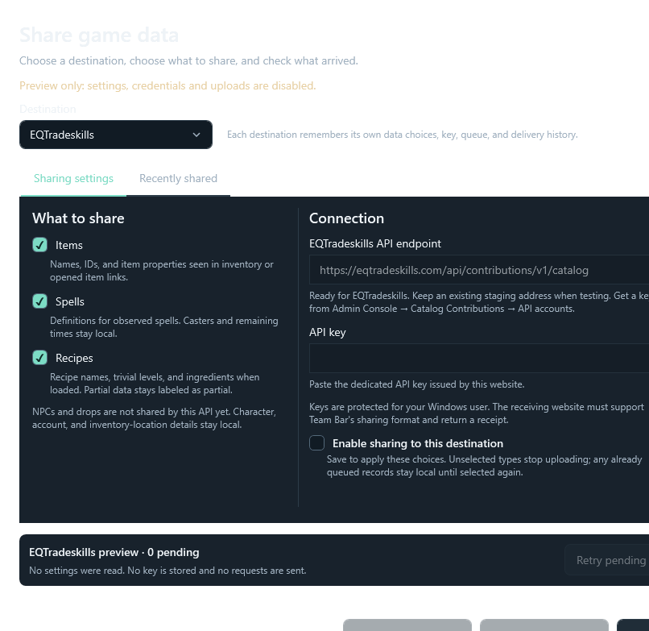

# Configure API contributions

Team Bar can send observations from supported game views to EQTradeskills or a compatible API. Each destination has its own credentials, selected data types, queue, and delivery history.

1. In **Settings → Memory Reading**, select **Enable Data Collection**.
2. Open **Data Collection** and its **Share game data** settings. Select **EQTradeskills** or **Generic API**. Enter the endpoint and dedicated API key supplied by that destination.
3. Choose the categories to share. EQTradeskills accepts items, spells, and recipes. For a generic API, select categories supported by its receiver. Turn on **Enable sharing to this destination** and select **Save**.

4. Open a supported view in the game. For example, opening a tradeskill window can expose recipe entries. Selecting a recipe can supply its ingredient details.
5. Open **Recently shared** to check delivery receipts. A receipt confirms that the destination received the observation. It may review the data before publishing it.

You can turn sharing off for one destination without changing the other. Windows protects saved API keys for the current user. Keep keys out of GitHub issues, screenshots, and exported examples.

[All guides](README.md)
