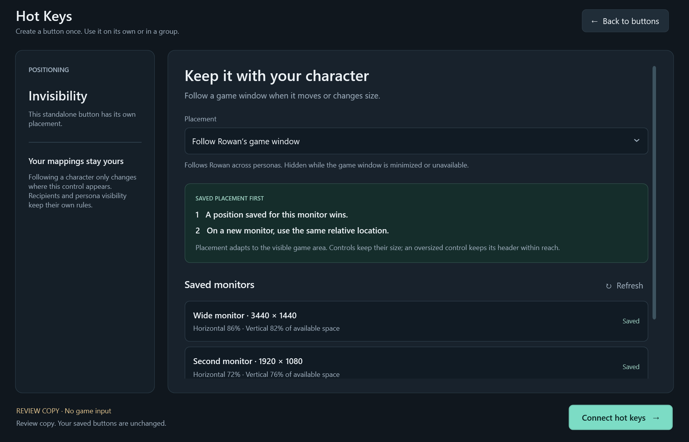
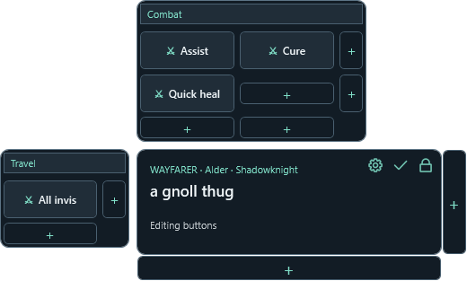
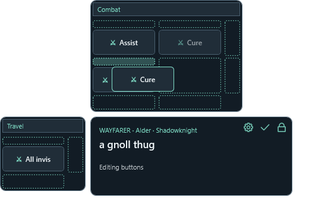

# Arrange buttons and groups

A group holds references to your saved buttons. Adding a saved button to another group reuses its shortcuts.

## Build a floating group

1. In **Hot Keys**, switch to **Groups** and choose **+ Add group**. Use the pencil to rename the group, or leave its title blank.
2. Select **+ Button** in a column. Search for a saved button and check its recipients and shortcut. Use **+ Column** to add another column.
3. Drag a button’s dotted grip to reorder it or move it between columns. You can also select a row and use **Alt** with an arrow key.
4. Open **Position** to choose free placement or follow a character’s game window. Set size, opacity, and movement locking in **Settings → Floating controls**.

## Edit buttons on a spell overlay

1. Select the **pencil** on a spell overlay. Click a group’s title to rename it, or clear the field to hide the title during play. Press **Enter** to save or **Esc** to cancel.
2. Use **+** on an empty edge to place its first button. Inside a group, click **+** in the row and column you want. For example, click the **+** to the right of the third button to start a new column on row three. The two spaces above it stay empty until you fill them. The **+** below each column adds a button on the next row of the group.
3. Pick a saved button to add it to the bar. Its name, icon, and shortcuts stay in sync everywhere you use it. Choose **Create button…** if you want a different button.
4. To edit a placed button, click it. Select the shortcut beside each recipient and press the keys together. Click the icon beside the name to search by icon ID or by a spell name from your EQ installation. Builds that include item names also let you search by item name. Clear the name for a centered icon.
5. Select **Done** to save the button, then the bar’s checkmark to finish editing. Removing the last button in a column collapses it. If the whole group is empty, use the **+** on that edge to add its first button again.

While the pencil is on, drag a button to rearrange it. The button menu closes and a preview follows your pointer. Drop into an empty dotted cell to line the button up with that row, or onto a thin dotted strip to insert it before another button. Each row also has a dotted space on the right for starting a new column there. The space under your pointer highlights before you release. Press **Esc** to cancel.

[All guides](README.md)
