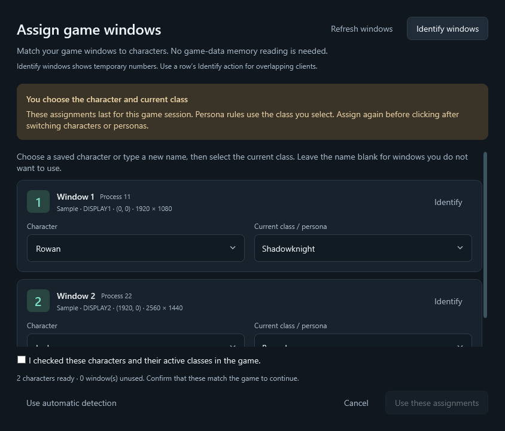
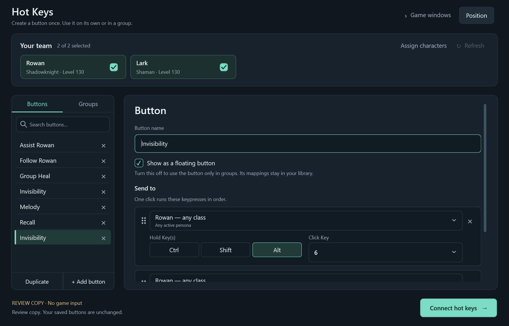

# Set up your first button

Hotkeys currently support EverQuest Live at `C:\EverQuest-Live`. If your game runs from another folder, Team Bar may show an empty character list in Hot Keys. Include that detail in your beta feedback.

Start with one action that already works from the keyboard in EverQuest.

1. Restore your game windows. In Team Bar, open **Hot Keys → Assign characters**.
2. Select **Identify windows** to see which row belongs to each window. Choose the character and current class in each row you want to use, confirm your assignments, and select **Use these assignments**. Update a manual assignment after changing characters, switching personas, or replacing a game window.

3. Open **Buttons → + Add button**. In **Send to**, pick a character, persona, or class. Choose the **Click Key** and any **Hold Key(s)**. Add a separate mapping for each recipient that needs a different shortcut.
4. Turn on **Show as a floating button** and select **Connect hot keys**. Hover the button to review its mappings. Click once to send its sequence.

The screenshot shows an Invisibility button that sends **Alt + 6** to Rowan. You can use the same saved button in a group, or turn off its floating display to keep only the grouped placement. [Arrange buttons and groups](button-groups.md)
