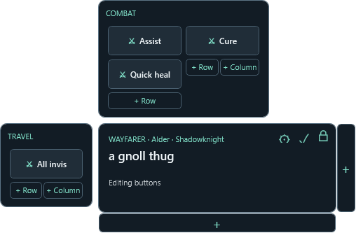

# Set up a spell overlay

A spell overlay shows a target’s effects, remaining time, and missing spells for a selected character or persona. These displays use optional game-data reading and require a supported game build.

1. In **Settings → Memory Reading**, select **Enable Spell Bar Data**. This lets Team Bar read target effects and timers for your overlays.
2. Open **Spell Overlays**, add a bar, and choose its character. In **Bar settings**, choose its class visibility and placement. You can leave the name blank.
3. Select **Add spells**, search the installed catalog or the current target, and choose the spells to watch. Order them within the NPC or Player section. Use **Mine**, **Others**, or **All** to choose whose effects count.
4. To make a row clickable, select its **Click Key** and any **Hold Key(s)**. Restore the game windows and show the overlay. The timer updates on its own. Clicking a mapped spell sends the configured shortcut.

The pencil lets you add shortcuts to the sides of this display. [Edit buttons on a spell overlay](button-groups.md#edit-buttons-on-a-spell-overlay)
